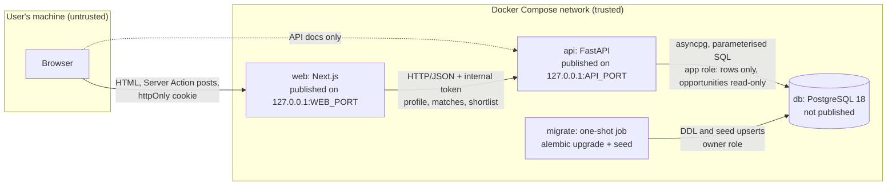
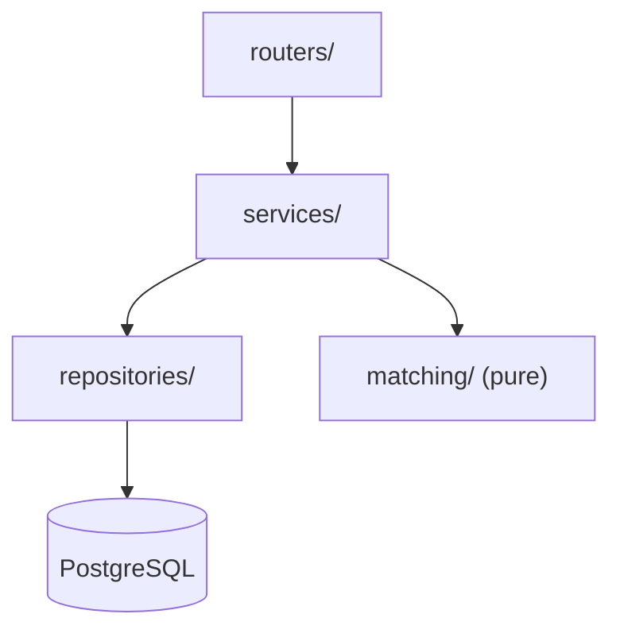
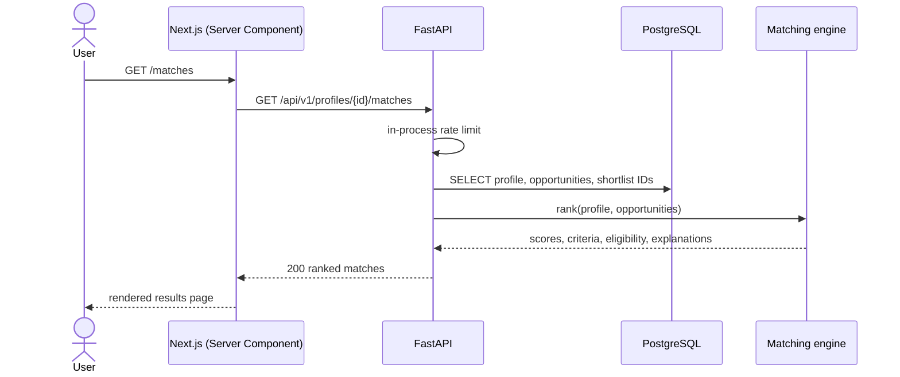
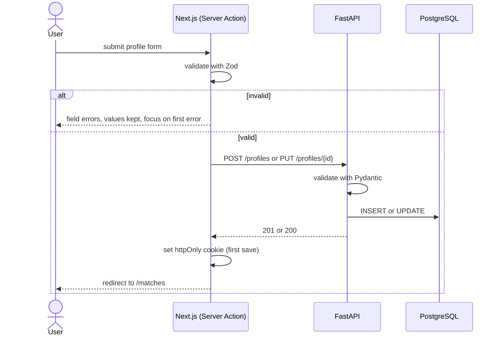
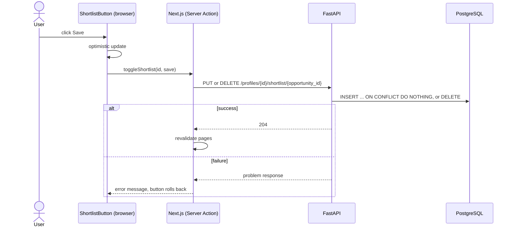
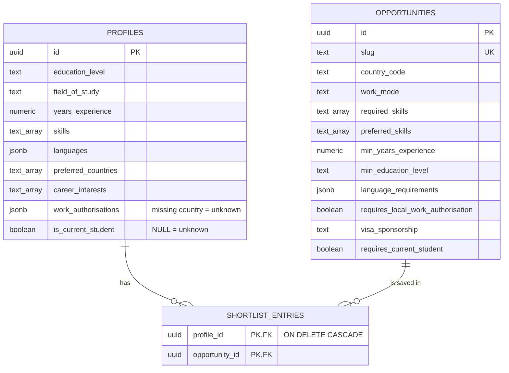
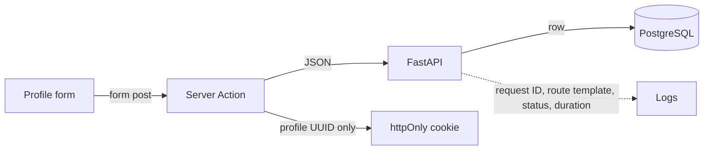

# MobilityMatch: career mobility prototype

A working prototype of an international career mobility platform. A user builds a career profile, the system scores twelve fictional opportunities against it, and returns a ranked list that explains every score and keeps eligibility (visa, language, enrolment) separate from fit.

- **Frontend:** Next.js 16 (App Router), React 19, TypeScript, Tailwind CSS 4
- **Backend:** FastAPI, Pydantic 2, SQLAlchemy 2.1 (async), Alembic
- **Database:** PostgreSQL 18
- **Matching:** rule-based and deterministic, in a pure Python module with no framework imports

More detail: [technical note](docs/technical-note.md) · [test evidence](docs/test-evidence.md) · [AI and tool disclosure](docs/ai-disclosure.md) · [implementation plan](PLAN.md)

## How to run it (no coding needed)

Allow about 15 minutes the first time. Most of it is waiting for downloads.

### What you need

- A Mac, Windows or Linux computer with about **5 GB of free disk space**
- An internet connection (needed for the first start only)
- **Docker Desktop**, a free app that runs this project in a self-contained box. Step 1 shows how to install it.

### Step 1: Install and open Docker Desktop

1. Download Docker Desktop from <https://www.docker.com/products/docker-desktop/> and install it like any other app.
   - **Windows:** if the installer asks to enable "WSL 2", say yes and restart the computer when asked.
2. Open **Docker Desktop** and wait until the bottom-left corner says **"Engine running"** (a green dot). You can skip any sign-in screen.

Docker Desktop must stay open while you use the app.

### Step 2: Unzip the project

If you received a `.zip` file, double-click it to unzip it. You get a folder called `mobility_platform` (the name may differ slightly). Put it somewhere easy to find, such as the Desktop.

### Step 3: Start the app

**On a Mac**

1. Open **Terminal**: press `Cmd + Space`, type `Terminal`, press `Enter`.
2. Type `cd ` (the letters c and d, then a space). **Do not press Enter yet.**
3. Drag the project folder from Finder into the Terminal window. Its location appears after `cd `. Now press `Enter`.
4. Type the following and press `Enter`:

   ```
   sh deployment/start.sh
   ```

**On Windows**

1. Open the project folder, then the **`deployment`** folder inside it.
2. Double-click **`start.bat`**.
   - If a blue window says "Windows protected your PC", click **More info**, then **Run anyway**.

**What happens next:** the first start downloads and builds everything, which takes **5 to 10 minutes**. Lots of text scrolls past; that is normal. When it finishes you will see **"Ready: http://localhost:3000"** and the app opens in your web browser. If the browser does not open, copy that address into it. The number at the end can differ if 3000 is already in use on your computer.

### Step 4: Try it

1. On the welcome page, click **Try the sample profile**. This fills in the fictional candidate from the assessment brief.
2. Click **See my matches**. You get 12 fictional opportunities ranked from best to worst fit, each with a score out of 100.
3. Click any role to see **why** it got its score: what matches, what is missing, and anything to verify, such as the right to work in that country.
4. Click **Save** on a role to add it to your shortlist. Open **Shortlist** at the top of the page to see the saved roles.
5. Click **Profile** to change something, for example add German as a language, and watch the rankings change.

All data in the app is fictional. Nothing is sent anywhere outside your computer.

### Stopping and starting again

- **Stop:** on a Mac, run `sh deployment/stop.sh` in Terminal from the project folder (steps 1 to 3 above, with `stop.sh` instead of `start.sh`). On Windows, double-click **`stop.bat`** in the `deployment` folder.
- **Start again later:** repeat Step 3. It takes less than a minute after the first time, and your saved profile and shortlist are still there.
- Closing Docker Desktop also stops the app.

### If something goes wrong

| What you see | What to do |
|---|---|
| "Docker is not installed" | Do Step 1, then start again. |
| "Docker is installed but not running" | Open Docker Desktop, wait for "Engine running", then start again. |
| "No such file or directory" on a Mac | Terminal is not in the project folder. Close Terminal and redo Step 3 carefully, including the drag and drop. |
| The browser says "This site can't be reached" | Wait one more minute and refresh the page. Check that Docker Desktop is still open. |
| The page says the service is unavailable | Stop the app, then start it again. |
| "The app did not start" or nothing helps | In the same window, run `cd deployment` and then `docker compose logs > logs.txt`, and send the `logs.txt` file from the `deployment` folder to the developer. |

## For developers

You need Docker with Docker Compose. Everything needed to run the stack is in `deployment/`, so run the `docker compose` commands below from that folder. The start scripts above create `deployment/.env` with random secrets and free ports on the first run. To do it by hand instead:

```sh
cd deployment
cp .env.example .env
# Edit .env: replace the two passwords and the token (see "Settings" below).
docker compose up --build
```

Then open <http://localhost:3000> and choose **Try the sample profile**. The API's interactive documentation is at <http://localhost:8000/docs>.

If port 3000 or 8000 is already in use, set `WEB_PORT` and `API_PORT` in `.env` (for example 3001 and 8001).

Startup order is handled by health checks: the database starts, a one-shot `migrate` job applies the schema and the seed data, then the API starts, then the web app. The `migrate` job re-runs on every start; the seed upserts by `slug`, so it never creates duplicates.

### Settings (`deployment/.env`)

This is a local prototype, not a production deployment. The settings exist so the app runs on your machine; the values only need to be unique, not managed like real secrets. `deployment/.env.example` holds this template:

```ini
# Owner role: used only by the migration job.
POSTGRES_USER=mobility_owner
POSTGRES_PASSWORD=change-me-owner-password
POSTGRES_DB=mobility

# Application role: can read and write rows, cannot change the schema.
APP_DB_USER=mobility_app
APP_DB_PASSWORD=change-me-app-password

# Shared secret between the web and api containers (at least 16 characters).
INTERNAL_TOKEN=change-me-to-a-long-random-string

# Set to false to hide the API's interactive docs at http://localhost:8000/docs
ENABLE_DOCS=true

# Ports on your machine. Change them if 3000 or 8000 are already in use.
WEB_PORT=3000
API_PORT=8000

# Set to true only when a reverse proxy you control sits in front of the web app
# and appends the real client address to X-Forwarded-For.
TRUST_PROXY=false
```

| Setting | What it does | Change it? |
|---|---|---|
| `POSTGRES_USER`, `POSTGRES_PASSWORD`, `POSTGRES_DB` | The database owner account. Only the `migrate` job uses it, to create tables and load the seed data. | Replace the password. The names can stay. |
| `APP_DB_USER`, `APP_DB_PASSWORD` | A second, limited account the API uses. It can read and write rows but cannot change or drop tables. | Replace the password. |
| `INTERNAL_TOKEN` | A shared secret that proves an API request came from the web server. At least 16 characters, or the API refuses to start. | Replace it. |
| `ENABLE_DOCS` | Shows the API's interactive docs at `http://localhost:<API_PORT>/docs`. | Optional. Leave `true` for reviewing. |
| `WEB_PORT`, `API_PORT` | The ports the app and the API use on your machine. | Only if 3000 or 8000 is already taken. |
| `TRUST_PROXY` | Whether to trust the client address a reverse proxy adds. Affects rate limiting only. | Leave `false` when running locally. |

Things to know:

- **Use letters and numbers only in passwords.** They are placed inside database connection URLs, where characters such as `@`, `/` or `:` break the connection. One way to make one: `openssl rand -hex 16`.
- **Passwords are fixed when the database is first created.** If you change them later, run `docker compose down -v` to recreate the database. This deletes saved profiles and shortlists; the 12 opportunities are re-seeded.
- **Don't share or commit `.env`.** It is already in `.gitignore`. `start.sh` and `start.bat` create it for you with random values on the first run.

### Run the tests

```sh
# Backend: matching engine, API and seed tests against a real PostgreSQL test database
(cd deployment && docker compose --profile test run --build --rm api-test)

# Engine tests only, without Docker (needs uv: https://docs.astral.sh/uv/)
cd backend && uv run pytest tests/matching

# Frontend: type check and lint
cd frontend && npm ci && npm run typecheck && npm run lint
```

### Reset everything

```sh
cd deployment && docker compose down -v   # removes the containers and the database volume, then re-seeds on next start
```

### Troubleshooting

| Symptom | Fix |
|---|---|
| `port is already allocated` or `address already in use` | Set `WEB_PORT` / `API_PORT` in `.env` to free ports |
| The API container keeps restarting | `docker compose logs migrate api`; check the values in `.env` |
| You changed passwords in `.env` after the first run | The database keeps its original roles. Run `docker compose down -v` and start again |
| The web page says the service is unavailable | The API or database is down: `docker compose ps` |
| Two copies of the project on one machine share a database | `deployment/docker-compose.yml` fixes the project name. Run the second copy with `COMPOSE_PROJECT_NAME=another-name` |

## Repository layout

```
mobility_platform/
  deployment/               everything needed to run the app
    docker-compose.yml      one command starts db, migrate, api and web
    .env.example            every setting, with placeholders (start.sh copies it to .env)
    start.sh, stop.sh       one-step start and stop for macOS and Linux
    start.bat, stop.bat     the same for Windows
  backend/                  FastAPI service (its own Dockerfile and lockfile)
    app/matching/           the pure matching engine: no framework or database imports
    app/routers/            HTTP routes only
    app/services/           use cases and transactions
    app/repositories/       SQLAlchemy queries
    app/models/             table models
    app/schemas/            Pydantic request and response models
    app/infra/              database engine, in-process rate limiter
    alembic/versions/       migrations: the only way the schema changes
    data/opportunities.json the 12 fictional opportunities
    db-init/01-roles.sh     creates the limited-privilege database role
    tests/                  engine, API and seed tests
  frontend/                 Next.js app (its own Dockerfile and lockfile)
    app/                    routes, Server Actions, error and not-found pages
    components/             UI components
    lib/                    API client, session cookie, Zod schemas, types
    proxy.ts                per-request CSP nonce
  docs/                     technical note, test evidence, AI disclosure, design screenshots
```

## Architecture

### Components and trust boundary



Only the Next.js server calls the API. Input is validated twice: with Zod in the Server Action and with Pydantic in the API.

### Backend layers



The engine imports nothing from the other layers, FastAPI, SQLAlchemy or Pydantic. `tests/matching/test_layering.py` fails if that changes.

### Requesting ranked matches



Matches are computed on every request. Nothing is cached, so results can never be stale.

### Saving a profile



### Shortlisting



### Database



### Where personal data goes



Checklist ticks are stored only in the browser's local storage and never sent to the server.

## API

Base path `/api/v1`. Full schemas at `/docs`.

| Method | Path | Success | Errors |
|---|---|---|---|
| GET | `/health/live` | 200 | |
| GET | `/health/ready` | 200 | 503 when PostgreSQL is down |
| POST | `/profiles` | 201 profile | 413, 422, 429 |
| GET, PUT, DELETE | `/profiles/{id}` | 200 / 200 / 204 | 404, 422, 429 |
| GET | `/opportunities`, `/opportunities/{id}` | 200 | 404, 429 |
| GET | `/profiles/{id}/matches?page=1&page_size=10&filter=all` | 200 `{items, page, page_size, total, total_pages, filter, counts}`; `page_size` 1–50, `filter` one of `all`, `strong`, `verify`, `clear`, `blocked`; a page past the end returns no items | 404, 422, 429 |
| GET | `/profiles/{id}/matches/{opportunity_id}` | 200 detail with breakdown and what-if | 404, 429 |
| GET | `/profiles/{id}/shortlist` | 200 | 404, 429 |
| GET | `/profiles/{id}/shortlist/ids` | 200 saved IDs only (cheap; used for the header count) | 404, 429 |
| PUT, DELETE | `/profiles/{id}/shortlist/{opportunity_id}` | 204 (idempotent) | 404, 429 |

Every error uses one RFC 9457 problem shape (`type`, `title`, `status`, `detail`, `request_id`, and `errors` for validation). No stack traces are ever returned.

## Not built (by design)

Authentication, payments, crawlers and live job-board integrations are out of scope in the brief. Redis and Celery are not used because nothing in this app needs them: scoring 12 roles takes milliseconds, and there is no background work. See the trade-offs in the [technical note](docs/technical-note.md).
