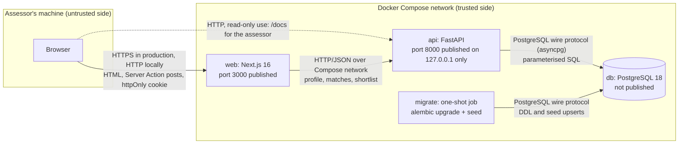
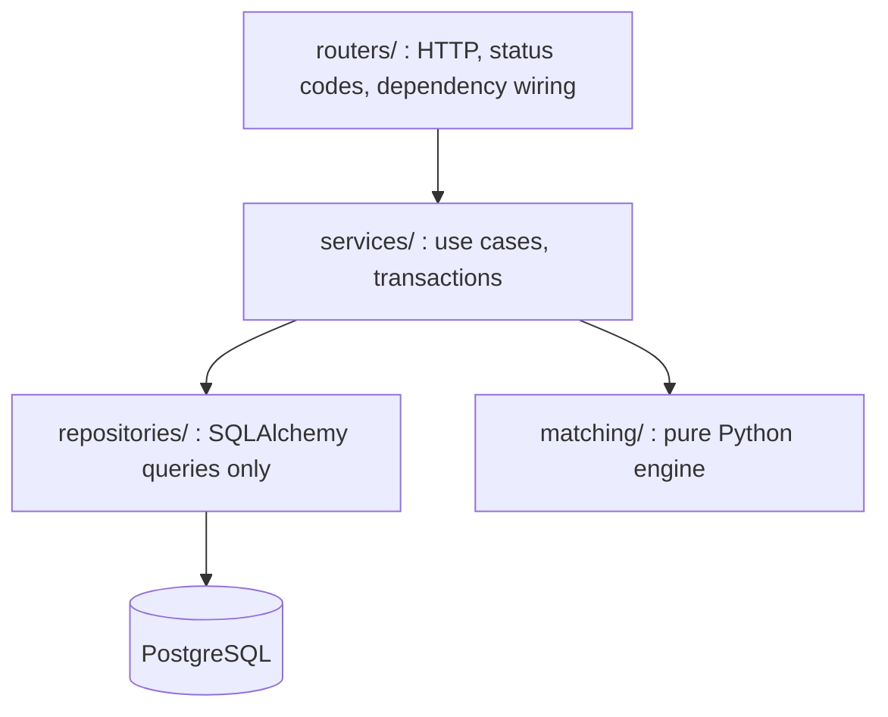
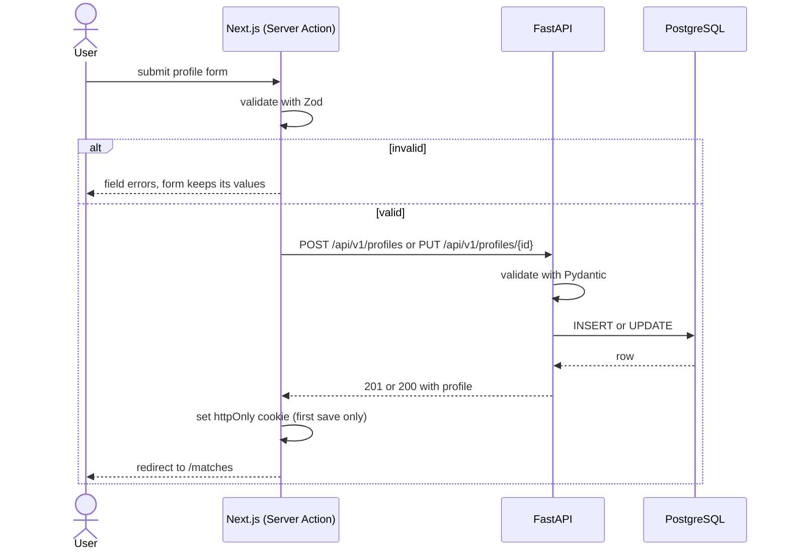
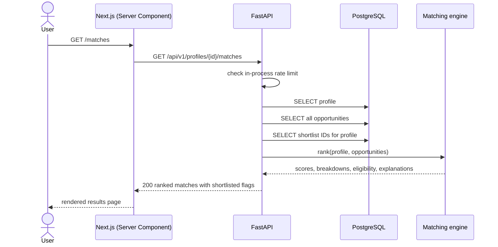
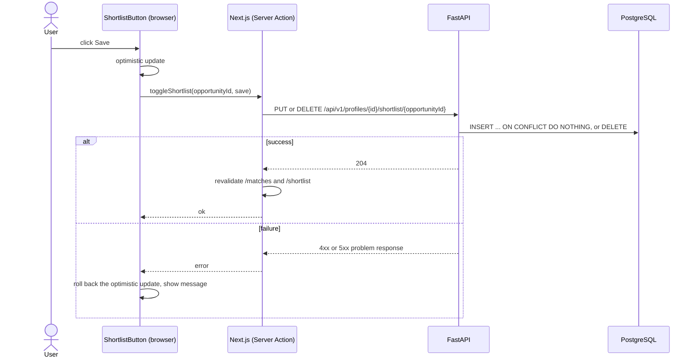
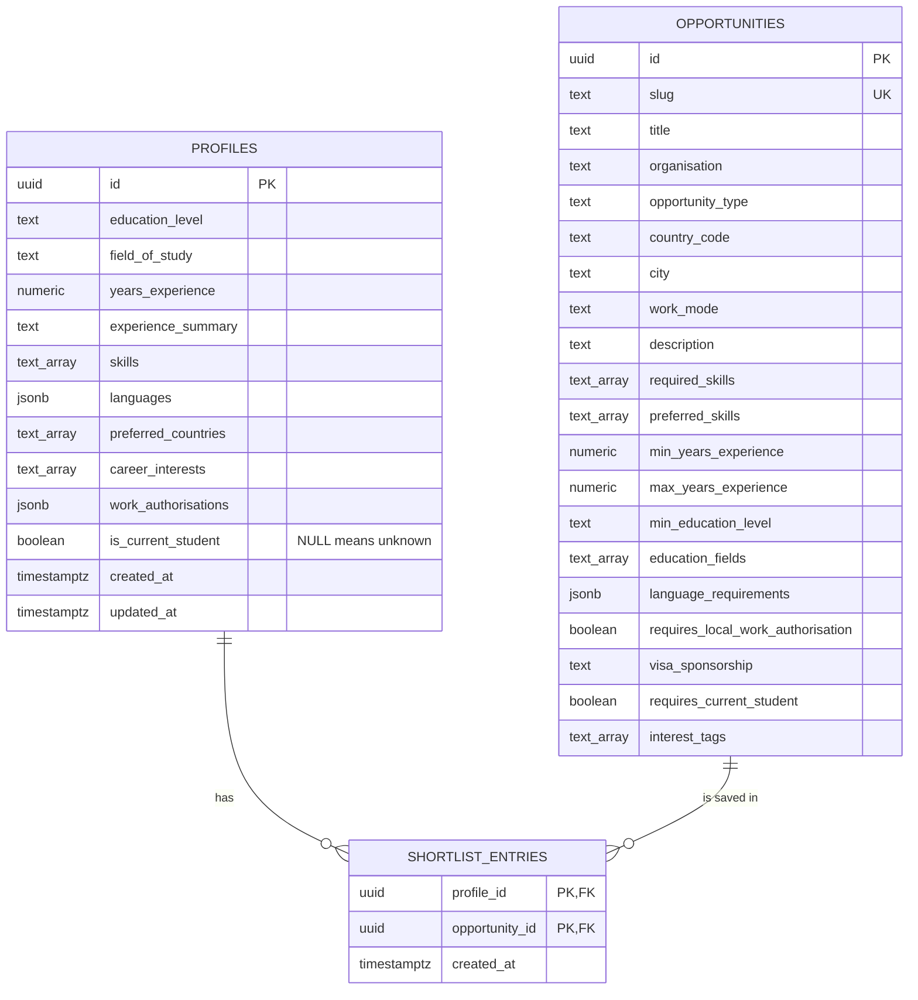
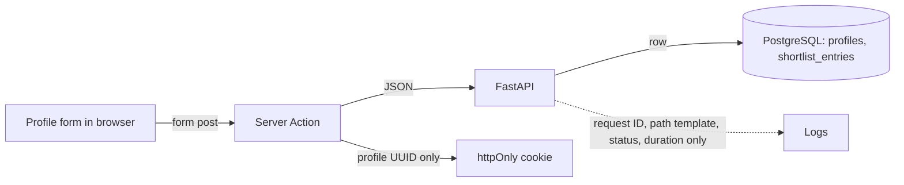

# Implementation Plan: Career Mobility Platform Prototype

Source brief: `Career_Mobility_Platform_Technical_Assessment.pdf`. No code has been written yet.

## 0. Assumptions and decisions that need your input

The prompt left three brackets unfilled. The plan assumes the values below; change any of them and the affected sections are marked.

| Item | Assumed | Affects |
|---|---|---|
| Time budget | 8 hours | Build order (section 12) |
| Experience | Strong React, moderate FastAPI | Design simplicity, assessor questions |
| Hosting | Local only, Docker Compose | Deliverables; no live demo link |

Decisions where I am unsure and want your call:

1. **The estimate is 8 hours with no slack.** PostgreSQL, migrations and Compose cost about 1 h 30 min of that. Section 12 gives the cut order if a step overruns.
2. **TypeScript: resolved during the build.** TypeScript 7.0.2 is the latest stable, but it ships only the native compiler with no JavaScript API, which Next.js and the ESLint TypeScript parser need. The build uses TypeScript 6.0.3, the latest 6.x, and the decision log records why.
3. **Redis and Celery are both left out, because neither is needed** (reasoning in sections 6.3 and 6.4). Rate limiting is done inside the API process. Section 2.12 states the conditions under which each would be added.
4. **Student status for the sample profile.** The brief does not say whether the sample candidate is currently enrolled. The plan treats it as unknown, so the Business Analyst Intern role shows "requires verification" and not "blocked". The alternative is to infer "not a student" from the completed degree, which would be an inference the brief warns against.
5. **No name or email is collected** in the profile. Matching does not need them, and leaving them out is the cheapest privacy control available.

## 1. Skills and tooling

Skills already in this session that apply:

| Skill | Use in this project |
|---|---|
| `/code-review` | After the matching engine, and again at the end |
| `/security-review` | Before submission; output feeds the security section of the technical note |
| `/simplify` | Before the final commit |
| `/run` | Launch the app and verify the full user journey |
| `claude-in-chrome` | Drive the browser for the journey check and screenshots for test evidence |
| `/init` | Create `CLAUDE.md` once the scaffold exists, so later sessions know the layout |
| `anthropic-skills:pdf` | Only if you want the technical note exported as a PDF |

Not applicable: the Remotion, Angie, spreadsheet, slides and Google Workspace skills.

Skills to install: none recommended. I did not verify the contents of any plugin marketplace, so I am not naming specific Next.js or FastAPI skills. The frameworks' own current documentation is enough for this scope. If you want to look, run `/plugin`, and install only plugins that state support for Next.js 16 and FastAPI 0.16x. Nothing will be installed without asking you.

## 2. System architecture

Every component below is built. Anything not built appears only in section 2.12.

### 2.1 Component diagram



Trust boundary: everything arriving from the browser is untrusted and validated twice, in the Server Action (Zod) and in the API (Pydantic). The API never trusts the web container to have validated.

Why each component exists:

| Component | Why it exists | What breaks without it |
|---|---|---|
| web (Next.js) | Renders the four screens and holds the profile cookie | No user interface |
| api (FastAPI) | Owns validation, persistence and the call into the matching engine | No matching, no stored data |
| db (PostgreSQL) | Durable store for profile, opportunities and shortlist | Data lost on restart; no uniqueness guarantee on shortlist |
| migrate (one-shot) | Applies the schema and seed before the API starts | API starts against an empty database |
| cache (Redis) | **Removed.** Matching 12 rows needs no cache, and one API process can count its own requests. | Nothing |
| worker (Celery) | **Removed.** There is no background job. | Nothing |

### 2.2 Backend layers



Dependency rule: routers call services; services call repositories and the engine; repositories know only the database. The `matching/` package imports nothing from the other layers, and nothing from FastAPI or SQLAlchemy. It takes plain dataclasses in and returns plain dataclasses out. A test in the suite scans its imports and fails if a forbidden one appears.

This is what keeps the engine testable alone: its tests construct a profile and an opportunity in memory and call one function, with no database, no network and no fixtures.

### 2.3 Frontend structure

```
app/
  layout.tsx                 server   shell, navigation, shortlist count
  page.tsx                   server   redirects to /profile or /matches
  profile/page.tsx           server   loads profile, renders ProfileForm
  matches/page.tsx           server   fetches ranked matches
  matches/[id]/page.tsx      server   fetches one match with full breakdown
  shortlist/page.tsx         server   fetches shortlisted matches
  error.tsx                  client   error boundary: "service unavailable, retry"
  not-found.tsx              server
  actions.ts                 server   Server Actions: saveProfile, deleteProfile, toggleShortlist
components/
  ProfileForm.tsx            client   form state, field errors (useActionState)
  TagInput.tsx               client   skills, interests, countries
  ShortlistButton.tsx        client   optimistic toggle (useOptimistic)
  ScoreBreakdown.tsx         server   per-criterion bars
  EligibilityBadge.tsx       server
  VerificationChecklist.tsx  server
lib/
  api.ts                     server-only fetch wrapper for the FastAPI service
  schemas.ts                 Zod schemas mirroring the Pydantic models
  session.ts                 reads and writes the httpOnly profile cookie
proxy.ts                     sets the CSP nonce and security headers
```

How the frontend reaches the API: only the Next.js server calls FastAPI, over the Compose network. Reads happen in Server Components; writes happen in Server Actions. The browser never calls the API for application data.

Reasons: the profile ID stays in an httpOnly cookie and never reaches client JavaScript; there are no cross-origin calls from the browser, so the API's CORS allowlist can be a single origin; and all data fetching is in one file (`lib/api.ts`), which is easy to explain live.

Cost of this choice: the API sees every request from the web container's address, so the web container forwards the client address in a header that the API trusts only from that container. The rate limiter uses that address.

### 2.4 Sequence: saving a profile



### 2.5 Sequence: requesting ranked matches



There is no cache, so there are no cache hit and miss paths. Matches are computed on every request from the current profile and catalogue, so results can never be stale and nothing needs invalidating.

### 2.6 Sequence: adding or removing a shortlist entry



Both operations are idempotent: saving twice or removing twice returns 204 and leaves one or zero rows.

### 2.7 Entity relationship diagram



### 2.8 Data flow of personal data



| Location | What is held | Lifetime |
|---|---|---|
| PostgreSQL `profiles` | The full profile | Until the user deletes it |
| PostgreSQL `shortlist_entries` | Profile ID and opportunity ID | Deleted with the profile (cascade) |
| API process memory | Rate-limit counters: a client address and a count. Match results are computed per request and never stored. | 60 seconds; lost on restart |
| Browser cookie | The profile UUID only | 30 days, cleared on delete |
| Logs | No profile fields. Paths are logged as templates, so the profile UUID is not in them. | Container lifetime |

Profile data lives in exactly one store, which keeps deletion simple and complete.

### 2.9 API contract

Base path: `/api/v1`.

| Method | Path | Request body | Success | Errors |
|---|---|---|---|---|
| GET | `/health/live` | none | 200 `{status}` | none |
| GET | `/health/ready` | none | 200 `{status, postgres}` | 503 if PostgreSQL is down |
| POST | `/profiles` | `ProfileIn` | 201 `ProfileOut` | 422, 429 |
| GET | `/profiles/{id}` | none | 200 `ProfileOut` | 404, 429 |
| PUT | `/profiles/{id}` | `ProfileIn` | 200 `ProfileOut` | 404, 422, 429 |
| DELETE | `/profiles/{id}` | none | 204 | 404, 429 |
| GET | `/opportunities` | none | 200 `OpportunityOut[]` | 429 |
| GET | `/opportunities/{id}` | none | 200 `OpportunityOut` | 404, 429 |
| GET | `/profiles/{id}/matches` | none | 200 `MatchSummary[]`, ranked | 404, 429 |
| GET | `/profiles/{id}/matches/{opportunity_id}` | none | 200 `MatchDetail` | 404, 429 |
| GET | `/profiles/{id}/shortlist` | none | 200 `MatchSummary[]` | 404, 429 |
| PUT | `/profiles/{id}/shortlist/{opportunity_id}` | none | 204 | 404, 429 |
| DELETE | `/profiles/{id}/shortlist/{opportunity_id}` | none | 204 | 404, 429 |

Every error uses one shape, based on RFC 9457 problem details:

```json
{
  "type": "about:blank",
  "title": "Validation failed",
  "status": 422,
  "detail": "One or more fields are invalid.",
  "errors": [{"field": "years_experience", "message": "Must be between 0 and 60."}],
  "request_id": "b1c2..."
}
```

Any unhandled exception returns status 500 in this shape with a generic detail and no stack trace. Database connection failures return 503.

### 2.10 Folder structure

```
mobility_platform/
  docker-compose.yml
  .env.example
  README.md
  docs/
    technical-note.md        the 1–2 page note
    test-evidence.md         test output and screenshots
    ai-disclosure.md         AI and tool usage log
  backend/
    pyproject.toml, uv.lock
    Dockerfile
    alembic.ini
    alembic/versions/        migrations; the only source of schema changes
    data/opportunities.json  seed data
    db-init/01-roles.sh      creates the limited-privilege application role (a shell script, so it can read the role password from the environment)
    app/
      main.py                app factory, lifespan, middleware, exception handlers
      config.py              typed settings from environment variables
      logging.py             JSON log formatter, request ID
      seed.py                idempotent seed command
      routers/               one file per resource; HTTP concerns only
      services/              use cases: profile, matching, shortlist
      repositories/          SQLAlchemy queries
      models/                SQLAlchemy table models
      schemas/               Pydantic request and response models
      infra/                 database engine and session, in-process rate limiter
      matching/              pure engine
        types.py             dataclasses for inputs and results
        normalise.py         skill synonym map, text normalisation
        criteria.py          one function per criterion, and the weights
        eligibility.py       hard-constraint checks
        explain.py           explanation text built from result data
        engine.py            score, rank, what-if
    tests/
      matching/              engine tests; no database
      api/                   endpoint tests
      fixtures/expected_ranking.json
  frontend/
    package.json, package-lock.json
    Dockerfile
    next.config.ts
    proxy.ts
    app/, components/, lib/  as listed in section 2.3
```

### 2.11 Failure behaviour

| Failure | What happens | What the user sees |
|---|---|---|
| PostgreSQL down | API returns 503; readiness returns 503 | Error page: "The service is temporarily unavailable. Nothing you entered was lost. Try again." with a retry button |
| API unreachable from the web container | `lib/api.ts` times out after 5 seconds and throws | The same error page as above |
| Validation failure | 422 with per-field errors | The form stays filled in, each invalid field shows its message, and focus moves to the first one |
| Unknown profile cookie (profile was deleted) | 404 from the API | Cookie cleared, redirect to the empty profile form |
| Rate limit exceeded | 429 with `Retry-After` | "Too many requests. Wait a moment and try again." |

### 2.12 Path to production (not built)

None of this is in the submission. It goes in the technical note under known limitations.

- Authentication and per-user authorisation; the profile UUID stops being the only key.
- TLS everywhere, managed secrets, encryption at rest for the database and its backups.
- Opportunities at real volume: filter candidates in PostgreSQL first (GIN indexes on skill arrays, or a search index), then score only those candidates.
- **Redis**, once the API runs as more than one process: shared rate-limit counters, and a cache of match results if scoring becomes slow at real catalogue sizes.
- **Celery or a similar job queue**, once there is real background work: ingesting job feeds on a schedule, recomputing matches for many users when the catalogue changes, sending alerts.
- A managed skills taxonomy to replace the synonym map.
- Read replicas, a CDN for static assets, metrics, tracing and alerting.
- Consent capture, retention limits and a data export function.

## 3. Data model

### 3.1 PostgreSQL schema

`profiles`

| Column | Type | Constraints |
|---|---|---|
| id | uuid | primary key, generated by the API (UUID version 4) |
| education_level | text | null allowed; check: one of `secondary`, `diploma`, `bachelor`, `master`, `doctorate` |
| field_of_study | text | null allowed; max 120 characters |
| years_experience | numeric(3,1) | null allowed; check 0 to 60 |
| experience_summary | text | null allowed; max 500 characters |
| skills | text[] | not null, default empty; max 50 items |
| languages | jsonb | not null, default `[]`; items `{language, level}` |
| preferred_countries | text[] | not null, default empty; ISO 3166-1 alpha-2 codes |
| career_interests | text[] | not null, default empty |
| work_authorisations | jsonb | not null, default `[]`; items `{country_code, status}` |
| is_current_student | boolean | null allowed; null means unknown |
| created_at, updated_at | timestamptz | not null |

`opportunities`: columns as in the diagram in section 2.7. `slug` is unique and is the key for the seed upsert. `visa_sponsorship` is one of `available`, `not_available`, `unknown`. `work_mode` is one of `onsite`, `hybrid`, `remote`. `opportunity_type` is `job` or `internship`.

`shortlist_entries`: composite primary key `(profile_id, opportunity_id)`, both foreign keys with `ON DELETE CASCADE`. The primary key is the uniqueness guarantee: one entry per profile and opportunity.

Indexes: only the primary keys and the unique index on `opportunities.slug`. Every query in the app is a primary-key lookup, a full read of the opportunities table, or a lookup by `profile_id`, which the composite primary key covers because `profile_id` is its first column. A GIN index on `required_skills` would not be used by any query, so it is not added.

Arrays and JSONB versus join tables: skills, countries and interests are stored as `text[]` because they are plain value lists that are always read and written whole. Languages and work authorisations are JSONB because each item is a small object. The cost is that there is no foreign key to a shared skills table, so spelling variants are handled in the engine's synonym map. A real product would normalise skills into their own table. This goes in the decision log.

### 3.2 How unknown work authorisation is represented

`work_authorisations` is a list of `{country_code, status}` where status is `authorised` or `not_authorised`. A country that is **absent from the list is unknown**. An empty list means the user has stated nothing, which is the sample profile's case.

This gives three states per country without overloading null, and it means the default for a new profile is "unknown everywhere". There is no value in the model that means "confirmed": the strongest state is "the user says they are authorised", and the interface always labels it as self-declared.

### 3.3 Pydantic models (Pydantic 2)

```
LanguageLevel    = basic | conversational | professional | fluent | native   (ordered 1 to 5)
EducationLevel   = secondary | diploma | bachelor | master | doctorate       (ordered 1 to 5)

LanguageSkill        { language: str (1..40), level: LanguageLevel }
WorkAuthorisation    { country_code: str (2 letters), status: authorised | not_authorised }

ProfileIn {
  education_level: EducationLevel | None
  field_of_study: str | None                (max 120)
  years_experience: Decimal | None          (0..60)
  experience_summary: str | None            (max 500)
  skills: list[str]                         (max 50 items, each 1..60, de-duplicated)
  languages: list[LanguageSkill]            (max 15, unique by language)
  preferred_countries: list[str]            (max 20, valid ISO codes)
  career_interests: list[str]               (max 20)
  work_authorisations: list[WorkAuthorisation]   (unique by country)
  is_current_student: bool | None
}
ProfileOut = ProfileIn + { id, completeness: Completeness, updated_at }

OpportunityOut { id, slug, title, organisation, opportunity_type, country_code, city,
                 work_mode, description, required_skills, preferred_skills,
                 min_years_experience, max_years_experience, min_education_level,
                 education_fields, language_requirements, requires_local_work_authorisation,
                 visa_sponsorship, requires_current_student, interest_tags }

CriterionResult   { criterion, points_earned, points_possible, status, matched[], missing[], note }
EligibilityCheck  { kind: language | work_authorisation | enrolment,
                    status: met | not_met | verification_required, message }
MatchSummary      { opportunity: OpportunityOut (short form), score, band, eligibility,
                    headline_strengths[], headline_gaps[], shortlisted }
MatchDetail       = MatchSummary + { criteria: CriterionResult[], eligibility_checks: EligibilityCheck[],
                    verification_checklist[], explanation, what_if[] }
```

All models set `extra="forbid"` and strip whitespace, so unexpected fields are rejected.

## 4. Matching logic

Rule-based, deterministic, no external service. The same inputs always give the same output.

### 4.1 Fit score (0 to 100)

| Criterion | Weight | Rule |
|---|---|---|
| Skills | 35 | Required-skill coverage, after normalisation. If the role lists preferred skills: `35 × (0.8 × required coverage + 0.2 × preferred coverage)`. Otherwise `35 × required coverage`. |
| Experience | 20 | At or above the minimum: full points. Below: `20 × years ÷ minimum`. More than 3 years above the stated maximum: 14 points with a "may be overqualified" note. |
| Education | 15 | 9 points if the level meets the minimum; 6 points if one of the role's listed fields appears as whole words in the field of study, or the role lists none. |
| Language | 15 | `15 × (required languages met ÷ required languages)`. |
| Location | 10 | Role's country is in the preferred list: 10. Remote role in a country not on the list: 5. Otherwise 0. |
| Career interests | 5 | `5 × matching interests ÷ min(user's interests, role's tags)`, capped at 5, so adding interests never lowers a score. |

Bands: strong is 75 and above, partial is 50 to 74, poor is below 50.

Skills carry the most weight because they are the most specific evidence of fit. Location is low because it is a preference and not a requirement. The weights live in one constants block, so a live request to "change a weight" is a one-line edit followed by a test run.

### 4.2 Missing data

| Situation | Points | Status shown |
|---|---|---|
| The role states no requirement for the criterion | Full | "No requirement stated" |
| The role states a requirement and the profile has the data | By the rule above | Met, partly met or not met |
| The role states a requirement and the profile field is empty | 0 | "Unknown: add this to your profile" |

Missing data is never scored as satisfied. Giving zero is a deliberate, conservative choice: the alternative, half credit, would invent evidence. The cost is that an incomplete profile scores low everywhere, so the interface shows a completeness indicator that names the empty fields and says the scores are less reliable because of them.

### 4.3 Eligibility, kept apart from the score

Eligibility checks never change the fit score. Each check returns `met`, `not_met` or `verification_required`.

| Check | `met` | `not_met` | `verification_required` |
|---|---|---|---|
| Required language | The profile lists the language at or above the required level | The profile lists languages, and this one is absent or below the level | The profile's language list is empty |
| Work authorisation (when the role requires local authorisation) | never | The user declared `not_authorised` and sponsorship is `not_available` | Every other case, including a user who declared `authorised` (shown as "self-declared, verify with the employer or the immigration authority") |
| Current enrolment (when the role requires it) | The user answered yes | The user answered no | Not answered |

Work authorisation can never reach `met`, because the app has no way to confirm it. This is the direct implementation of the brief's instruction not to present an inferred status as a legal determination.

Overall eligibility is the worst result across the checks:

- `blocked`: at least one check is `not_met`.
- `requires_verification`: none is `not_met`, at least one needs verification.
- `no_known_blockers`: everything applicable is met. The label is deliberately not "eligible".

### 4.4 Ranking

Sort by: not blocked before blocked, then fit score descending, then slug ascending for a stable order on ties. A blocked role keeps its real fit score and stays visible, in a separate group at the bottom, so the user can see "this would suit you, and here is the one thing that stops it".

### 4.5 Explanations

`explain.py` builds the text only from the `CriterionResult` and `EligibilityCheck` objects. It has no access to the profile or the opportunity, so it cannot state something the score does not contain. Example output:

> Strong fit (86/100). You match 3 of 3 required skills (reporting, project coordination, stakeholder communication). Your 2 years of experience meets the 1 to 2 years asked for. Germany is one of your preferred locations. To verify: this role requires the right to work in Germany, and your profile does not state your status.

## 5. Sample opportunities and intended outcomes

Twelve opportunities in `backend/data/opportunities.json`. Outcomes are for the sample profile in the brief. Exact scores will be fixed when the engine is written; the bands and eligibility below are the contract checked by the expected-ranking test.

| # | Role | Location | Key requirements | Fit band | Eligibility |
|---|---|---|---|---|---|
| 1 | Programme Assistant, International NGO | Berlin, Germany | Business or social science degree; 1 to 2 years; reporting, project coordination, stakeholder communication; English | Strong | Requires verification (work authorisation) |
| 2 | Business Operations Associate, logistics firm | Singapore | Excel, reporting, research; 1 to 3 years; English; sponsorship available | Strong | Requires verification (work authorisation) |
| 3 | Project Coordinator, engineering consultancy | Toronto, Canada | Project coordination, stakeholder communication, reporting; preferred: MS Project; 2 years; English | Strong | Requires verification (work authorisation) |
| 4 | Graduate Trainee, Business Operations | Singapore | Bachelor's degree; Excel, reporting; citizens and permanent residents only, no sponsorship | Strong | Requires verification (work authorisation, flagged as a likely barrier) |
| 5 | Business Analyst Intern, technology firm | Vancouver, Canada | Data analysis, Excel, presentation; currently enrolled student; local work eligibility | Partial | Requires verification (enrolment and work authorisation) |
| 6 | Research Assistant, policy institute | Singapore | Research, reporting, statistics (SPSS), academic writing; 0 to 2 years | Partial | Requires verification (work authorisation) |
| 7 | Operations Analyst, fintech | Amsterdam, Netherlands | Excel, SQL, reporting; 2 years; English | Partial | Requires verification (work authorisation) |
| 8 | Junior Project Manager, remote | United Kingdom, remote | Project coordination, budgeting, risk management; 4 years; no local authorisation required | Partial | No known blockers |
| 9 | German-speaking Client Associate | Munich, Germany | Professional German; customer support experience | Partial | Blocked (German not listed) |
| 10 | Marketing Coordinator, bilingual | Montréal, Canada | Professional French and English; content, campaign reporting | Poor to partial | Blocked (French not listed) |
| 11 | Senior Programme Manager, international agency | Geneva, Switzerland | Master's degree; 7 years; professional French | Poor | Blocked (French not listed) |
| 12 | Software Engineer, backend | Berlin, Germany | Python, cloud platforms; computer science degree | Poor | Requires verification (work authorisation) |

This covers the brief's three example roles (1, 5, 9), strong, partial and poor matches, three language constraints (9, 10, 11) and two distinct eligibility constraints (4 and 5), with role 8 as the contrast case that has none.

## 6. Infrastructure and good practice

### 6.1 Docker Compose

One command: `docker compose up --build`. Services: `db`, `migrate`, `api`, `web`.

- Health checks: `pg_isready` for db, `/api/v1/health/ready` for api.
- Startup order: `migrate` waits for db to be healthy; `api` waits for `migrate` to complete successfully; `web` waits for api to be healthy.
- Named volume for PostgreSQL data. The PostgreSQL 18 image changed its data directory layout, so the volume is mounted at `/var/lib/postgresql` and not the older `/var/lib/postgresql/data`. Confirm against the image's documentation when writing the file.
- Only `web` (3000) and `api` (127.0.0.1:8000, for the interactive API docs) are published.
- `.env.example` lists every variable with a placeholder. The README step is `cp .env.example .env`.
- No `version:` key in the Compose file; it is obsolete.

### 6.2 PostgreSQL

- Schema changes only through Alembic. `Base.metadata.create_all` is never called.
- Two roles: an owner role used by the `migrate` job, and an application role with select, insert, update and delete only. The API cannot alter or drop tables.
- Async SQLAlchemy engine with a small bounded pool (`pool_size=5`, `max_overflow=5`, `pool_pre_ping=True`).
- The seed command upserts by `slug` (`INSERT ... ON CONFLICT (slug) DO UPDATE`), so running it twice changes nothing.

### 6.3 Redis: not needed, left out

Redis had two candidate jobs, and neither needs it at this size:

- **Caching match results.** Scoring 12 opportunities is a few milliseconds of pure Python. A cache would add an invalidation rule and a second copy of personal data for no measurable gain.
- **Rate limiting.** The API runs as one process, so it can count requests in its own memory.

Rate limiting is still built, as a fixed-window counter in the API process: about 20 lines, no dependency. Limits are 60 requests per minute per client for reads and 20 for writes, returning 429 with `Retry-After`. Its limits are stated in the technical note: counters reset on restart and are not shared between processes, so the API runs with a single worker. Running more than one API process is the point at which Redis becomes necessary.

### 6.4 Celery: not needed, left out

There is no background job in this app. Matching belongs in the request because it is fast and the user is waiting for the answer. Putting it in a queue would add a worker, a broker, a polling endpoint and a loading state, and make the user wait longer for the same result.

The technical note will say when Celery becomes necessary: ingesting external job feeds on a schedule, recomputing stored matches for many users when the catalogue changes, and sending notifications. It will also list the practices that would apply then (JSON serialisation, idempotent tasks, IDs as arguments, bounded retries with backoff and jitter, time limits, late acknowledgement, result expiry, eager-mode tests), so the reasoning is on record without unbuilt code being claimed.

### 6.5 Configuration, logging, health

- `config.py`: a `pydantic-settings` class; the app refuses to start if a required variable is missing.
- Logging: JSON lines from the standard library `logging` module with a small formatter. Fields: timestamp, level, request ID, method, path template, status, duration. No request bodies.
- `/health/live` returns 200 if the process is up. `/health/ready` checks PostgreSQL with `SELECT 1`.

## 7. Dependencies

Versions were looked up on **2026-11-16** from the npm registry, PyPI, Docker Hub and endoflife.date. Recheck on the day you scaffold; several of these release weekly.

### 7.1 Runtimes and images

| Component | Version | Image tag | Status |
|---|---|---|---|
| Node.js | 26.13.1 | `node:26.13.1-slim` | Active LTS since 2026-10-28 |
| Python | 3.14.10 | `python:3.14.10-slim` | Supported; every backend package lists 3.14 |
| PostgreSQL | 18.7 | `postgres:18.7-alpine` | Supported until November 2030 |

Python 3.15 is newer, but asyncpg does not yet list it, so 3.14 is the safe current choice. All three image tags were confirmed to exist on Docker Hub.

### 7.2 Backend packages

| Package | Version | Why it is needed |
|---|---|---|
| fastapi | 0.163.1 | HTTP framework |
| uvicorn | 0.54.0 | ASGI server |
| pydantic | 2.14.3 | Validation and response models |
| pydantic-settings | 2.16.3 | Typed configuration |
| sqlalchemy | 2.1.8 | Async ORM |
| asyncpg | 0.32.0 | PostgreSQL driver |
| alembic | 1.20.1 | Migrations |
| pytest | 9.2.0 | Tests (development only) |
| pytest-asyncio | 1.5.0 | Async tests (development only) |
| httpx | 0.28.1 | Required by FastAPI's test client (development only) |
| ruff | 0.17.5 | Lint and format (development only) |
| pip-audit | 2.10.1 | Vulnerability scan (development only) |

Package manager: `uv` 0.13.8 with a committed `uv.lock`.

Left out on purpose: redis (section 6.3), Celery (section 6.4), slowapi (the limiter is about 20 lines of plain Python), structlog (the standard library is enough).

Notes: FastAPI still labels itself beta in its package metadata; it is the framework you chose and is in wide production use. httpx's latest release dates from December 2024; it is not marked deprecated, and it is a test-only dependency here.

### 7.3 Frontend packages

| Package | Version | Why it is needed |
|---|---|---|
| next | 16.4.6 | Framework |
| react, react-dom | 19.3.1 | User interface library |
| typescript | 6.0.3 | Type checking (7.0.2 has no JavaScript API; see section 0) |
| tailwindcss, @tailwindcss/postcss | 4.3.5 | Styling |
| zod | 4.6.7 | Validation in Server Actions |
| eslint | 10.15.0 | Lint |
| eslint-config-next | 16.4.6 | Next.js lint rules; accepts ESLint 9 and above |

Left out on purpose: react-hook-form (React 19's `useActionState` covers the one form), a component library, a client data-fetching library, and a frontend unit-test runner (see section 9).

### 7.4 Deprecated patterns to avoid

These are from my knowledge of each project; confirm each against the current documentation and migration guide during scaffolding.

| Avoid | Use |
|---|---|
| FastAPI `@app.on_event("startup")` | `lifespan` context manager |
| Pydantic 1 `@validator`, `class Config`, `.dict()`, `.json()` | `@field_validator`, `model_config`, `.model_dump()`, `.model_dump_json()` |
| SQLAlchemy `declarative_base()`, `session.query()`, `Column` | `DeclarativeBase`, `select()`, `Mapped` and `mapped_column` |
| `datetime.utcnow()` | `datetime.now(UTC)` |
| pytest-asyncio's `event_loop` fixture | Loop scope configuration |
| Next.js `middleware.ts` | `proxy.ts` |
| `next lint` | Running ESLint directly with a flat config |
| Synchronous `params`, `searchParams`, `cookies()`, `headers()` | Awaiting them |
| Pages Router, `getServerSideProps` | App Router, Server Components |
| `forwardRef`, `useFormState` | `ref` as a prop, `useActionState` |
| `tailwind.config.js` with `@tailwind` directives | CSS-first configuration with `@import "tailwindcss"` |
| `.eslintrc` | `eslint.config.mjs` |
| `docker-compose` (version 1) and the `version:` key | `docker compose` |

### 7.5 Audit gates

`npm audit --audit-level=high` and `uv run pip-audit` run in the build order. A high or critical finding fails the final checklist.

## 8. Security: OWASP Top 10:2025

The current edition is **OWASP Top 10:2025**, confirmed at owasp.org on 2026-11-16 (the Top 10 page redirects to the 2025 edition).

| Category | Risk in this app | Control | Where | How it is tested |
|---|---|---|---|---|
| A01 Broken Access Control | Anyone who knows a profile UUID can read or change that profile | **Partly addressed; known limitation.** Random UUID version 4 as an unguessable identifier, held in an httpOnly cookie, never shown in the interface. Authentication is out of scope. | `lib/session.ts`, profile routes | Test that an unknown UUID returns 404 and that no endpoint lists profiles |
| A02 Security Misconfiguration | Open CORS, exposed database, verbose errors, default credentials | Single-origin CORS allowlist; db not published; limited database role; non-root containers; security headers and a nonce-based Content Security Policy; API docs can be switched off by environment variable | `main.py`, `docker-compose.yml`, `proxy.ts`, `db-init/` | Test: a request from another origin gets no CORS headers. Test: the response headers are present. Manual: `docker compose ps` shows no published port for db. |
| A03 Software Supply Chain Failures | A vulnerable or tampered dependency | Pinned versions, committed lockfiles, pinned image tags, short dependency list, `npm audit` and `pip-audit` | `uv.lock`, `package-lock.json`, Dockerfiles | The two audit commands; output saved in test evidence |
| A04 Cryptographic Failures | Personal data sent or stored unencrypted | **Documented, not built.** Local demo runs over HTTP. Production needs TLS, encryption at rest, and the cookie's `Secure` flag (already set when `NODE_ENV=production`). No passwords or secrets are stored. | Technical note; `lib/session.ts` | Test that the cookie is `HttpOnly` and `SameSite=Lax` |
| A05 Injection | SQL injection through profile fields; script injection through user text | SQLAlchemy bound parameters only, no string-built SQL; React escapes all output; no `dangerouslySetInnerHTML`; Pydantic rejects unknown fields and over-long input | `repositories/`, components | Test: a profile containing `'; DROP TABLE` and `<script>` round-trips as plain text |
| A06 Insecure Design | Presenting a guess about visa status as fact; over-collecting data; unlimited request volume | Eligibility model that cannot express "confirmed"; no name or email collected; size limits on every list; in-process rate limiter | `matching/eligibility.py`, schemas, `infra/` | Engine tests: unknown authorisation never yields `met`. API test: the limit returns 429. |
| A07 Authentication Failures | No authentication exists | **Not applicable to the build; known limitation.** The technical note states what production needs: an identity provider, sessions bound to a user, and profile access checked against the signed-in user. | Technical note | None |
| A08 Software or Data Integrity Failures | Unverified data loaded at startup; unsafe deserialisation | No pickle or other code-carrying formats anywhere; the seed file is validated through the Pydantic models before insert, and a bad record stops the seed with a clear message | `seed.py` | Test: a seed record with an invalid field is rejected |
| A09 Security Logging and Alerting Failures | No trace of failures; personal data leaking into logs | JSON logs with request ID for every request, including 4xx, 5xx and rate-limit hits; no bodies and no profile fields logged. Alerting is **not built**. | `logging.py`, middleware | Test: a captured log line for a profile save contains no profile field values |
| A10 Mishandling of Exceptional Conditions | Stack traces returned to users; hanging on a dead dependency | Global exception handlers returning the problem format; timeouts on database calls and frontend fetches; a database failure fails closed with 503 | `main.py`, `infra/` | Tests: forced exception returns a generic 500; database failure returns 503 |

Other controls: request body limit of 64 KB; fictional data only, with the sample profile from the brief as the seed for the demo.

### Privacy section for the technical note

- **What is stored:** education, experience, skills, languages, location preferences, interests, self-declared work authorisation and student status. No name, email or contact details.
- **Where and how long:** PostgreSQL only, as in the table in section 2.8. Nothing is cached.
- **Deletion:** a "Delete my profile" button calls `DELETE /profiles/{id}`, which removes the profile row, cascades to the shortlist and clears the cookie. An API test checks that the profile and its shortlist rows are gone.
- **Production changes:** TLS, encryption at rest, authentication, recorded consent, a retention period with automatic deletion, data export, and treating work-authorisation status as sensitive data with restricted access.

## 9. Tests

### 9.1 Matching engine (pytest, no database)

The three cases the brief requires, against the sample profile:

| Case | Opportunity | Asserts |
|---|---|---|
| Strong match | Programme Assistant, International NGO | Band is strong; all three required skills matched; eligibility is `requires_verification` because of work authorisation, not `no_known_blockers` |
| Partial match | Operations Analyst, fintech | Band is partial; SQL listed as a missing skill; location earns 0 |
| Critical requirement gap | German-speaking Client Associate | Eligibility is `blocked`; the reason names German; the fit score is still calculated and reported |

Edge cases:

- Empty profile: every score is 0 or "no requirement" points only, nothing is marked met, completeness lists all fields.
- Unknown work authorisation never produces `met`; declared `authorised` still produces `verification_required`.
- Declared `not_authorised` with no sponsorship produces `blocked`.
- Student status: yes, no and unknown give three different results for the intern role.
- Skill normalisation: "MS Excel", "excel" and " Excel " all match "Excel".
- A role with no required skills does not divide by zero.
- Language level below the requirement counts as not met.
- Determinism: ranking the same input twice gives identical output; ties are ordered by slug.
- Explanation integrity: every skill named in the explanation appears in the criterion result.
- Layering: the `matching` package imports nothing from FastAPI or SQLAlchemy.
- **Expected-ranking fixture:** `expected_ranking.json` holds the band and eligibility for all 12 opportunities; one parametrised test checks each, and another checks that every blocked role ranks below every non-blocked one.

### 9.2 API (pytest with FastAPI's test client)

Run against a real PostgreSQL through Compose (`docker compose run --rm api pytest`).

- Profile create, read, update, delete; delete removes shortlist entries.
- Validation: negative experience, over-long strings, unknown fields, invalid country code, each returning 422 in the problem format.
- Shortlist: add twice gives one row; remove twice gives 204; unknown opportunity gives 404.
- Matches: a profile edit changes the results on the next request.
- Rate limit: the request after the limit returns 429 with `Retry-After`.
- Forced exception: 500 with no stack trace.

### 9.3 Frontend and end to end

No frontend unit-test runner, to protect time. The user journey is verified with `/run` and the browser tools, following a written script in `docs/test-evidence.md`: create the sample profile, view ranked results, open a detail view, shortlist, reload to confirm persistence, submit an invalid form, stop the database and confirm the error page appears. Screenshots go in the test evidence. A Playwright test for the same script is a stretch item.

## 10. Screens

| Screen | Content | State |
|---|---|---|
| Profile form (`/profile`) | Education, experience, skills, languages with levels, preferred countries, interests, optional work authorisation per country, student status with a "prefer not to say" option; a "Load sample profile" button; delete button | Client: field values and errors (`useActionState`). Server: the stored profile. |
| Ranked results (`/matches`) | Completeness indicator; cards in rank order with title, organisation, location, score, band, eligibility badge, top two strengths and gaps, shortlist button; blocked roles in a separate group at the bottom; filter by eligibility | Server-rendered. Client: optimistic shortlist state and the filter, held in the URL query. |
| Detail view (`/matches/[id]`) | Role requirements; score breakdown by criterion; explanation; eligibility checks; verification checklist; "what if" suggestions; shortlist button | Server-rendered. Client: shortlist state only. |
| Shortlist (`/shortlist`) | Saved roles with their current score and eligibility; remove button; empty state | Server-rendered from the database, so it survives reloads and restarts. |

A fixed line on the results and detail screens: "Eligibility notes are based only on what you entered. They are not legal advice or a confirmed immigration status."

## 11. Differentiation, ranked by value for effort

| Rank | Item | Scoring area | Cost | Verdict |
|---|---|---|---|---|
| 1 | (a) Score breakdown with explanations built from the same data | Matching quality (20%) | In the engine's core time | Keep; it is the engine's design |
| 2 | (b) Eligibility kept apart from fit | Matching quality (20%) | In the engine's core time | Keep; the brief asks for it directly |
| 3 | (g) Expected-ranking fixture and test | Testing (10%), matching quality | 15 min | Keep; it doubles as the test evidence |
| 4 | (h) Decision log | Communication (10%), product judgement (15%) | 10 min | Keep |
| 5 | (i) Honest limitations | Communication, product judgement | 10 min | Keep; the brief rewards it by name |
| 6 | (c) Verification checklist | Product judgement, matching quality | 10 min; it is a view of the eligibility checks | Keep |
| 7 | (f) Skill normalisation | Matching quality | 15 min | Keep a small map of about 15 entries |
| 8 | (d) Profile completeness indicator | Product judgement | 20 min | Drop second |
| 9 | (e) "What if" view | Product judgement | 25 min | Drop first |

The "what if" view is cheap only because the engine is pure: it re-runs the score with one missing skill or language added and reports the three largest gains. It is still the first thing to cut.

Leaving Redis and Celery out is itself a differentiator under product judgement (15%): the decision log shows a reasoned choice not to add infrastructure the problem does not need, which matches the brief's stated preference for a focused solution.

## 12. Build order

| # | Step | Time | Running total |
|---|---|---|---|
| 1 | Scaffold: repository, Next.js and FastAPI skeletons, TypeScript version check, Dockerfiles, Compose with health checks, `.env.example`, health endpoints, `/init` | 45 min | 0:45 |
| 2 | Matching engine: types, criteria, eligibility, normalisation, explanations, ranking, and its tests with the expected-ranking fixture | 90 min | 2:15 |
| 3 | `/code-review` on the engine; fix findings | 10 min | 2:25 |
| 4 | Database: models, Alembic migration, roles script, seed file with 12 opportunities, seed command | 40 min | 3:05 |
| 5 | API: schemas, repositories, services, routers, error handlers, API tests | 60 min | 4:05 |
| 6 | Frontend: profile form with validation and sample loader | 45 min | 4:50 |
| 7 | Frontend: ranked results, detail view, shortlist, error and empty states | 75 min | 6:05 |
| 8 | Completeness indicator and "what if" view | 30 min | 6:35 |
| 9 | Hardening: in-process rate limiter, `proxy.ts` headers and Content Security Policy, CORS, body limit, `npm audit`, `pip-audit` | 25 min | 7:00 |
| 10 | `/run` and the browser journey script; screenshots; `/security-review` | 20 min | 7:20 |
| 11 | README with diagrams, technical note, test evidence, AI disclosure | 30 min | 7:50 |
| 12 | `/simplify`, final `/code-review`, final checklist, commit | 10 min | 8:00 |

Infrastructure cost inside those numbers: Compose and containers about 30 minutes, PostgreSQL and migrations 40, hardening 25. Dropping Redis saved about 30 minutes against the earlier version of this plan.

Cut order if a step overruns, first to last:

1. "What if" view (saves 20 min).
2. Completeness indicator (saves 10 min).
3. Separate database roles; use one role and list it as a limitation (saves 10 min).
4. Nonce-based Content Security Policy; fall back to static security headers and say so (saves 10 min).

Never cut: the engine tests, the three required test cases, the technical note, the limitations section.

The AI disclosure log (`docs/ai-disclosure.md`) is updated at the end of every step, recording what was generated, what you changed and what you verified by hand.

### Final checklist

- [ ] `docker compose up --build` works from a fresh clone with only Docker installed.
- [ ] The sample profile produces the ranking in the expected-ranking fixture.
- [ ] All tests pass; output saved in test evidence.
- [ ] `npm audit` and `pip-audit` show no high or critical findings.
- [ ] Every control listed in section 8 as built exists in the code; every one marked not built is in the limitations.
- [ ] The diagrams match the code.
- [ ] No real personal data anywhere; no secrets committed.
- [ ] Technical note is two pages or fewer and includes the component diagram.
- [ ] AI disclosure is complete.
- [ ] You can explain every file without notes.

## 13. Deliverables

| Deliverable | File | Content |
|---|---|---|
| Working application | Compose project | Local setup; no live demo link under the current hosting assumption |
| Source code | Git repository or archive | README: prerequisites, setup, run, test, reset, all diagrams from section 2, troubleshooting |
| Technical note | `docs/technical-note.md` | Component diagram, data model summary, matching method with weights, decision log, privacy, known limitations |
| Test evidence | `docs/test-evidence.md` | Test run output, the three required cases with actual scores, journey screenshots, audit output |
| AI and tool disclosure | `docs/ai-disclosure.md` | Tools, libraries, what each was used for, what was reviewed by hand |

Decision log entries for the technical note:

| Decision | Alternative rejected | Reason |
|---|---|---|
| Rule-based matching | Embedding or language-model scoring | Deterministic, explainable per criterion, runs offline, needs no fallback |
| Eligibility separate from score | A penalty inside the score | A penalty hides the reason and lets a blocked role outrank an open one |
| Missing data scores zero | Half credit | Half credit invents evidence; the brief says not to treat missing data as satisfied |
| PostgreSQL | SQLite or a JSON file | Real constraints (composite key, cascade, check constraints), a limited-privilege role, and the same engine a real deployment would use. Cost: about 40 minutes and a Docker requirement. |
| No Redis | A match cache and a Redis-backed limiter | Scoring 12 rows takes milliseconds, and one API process can count its own requests. A cache would add an invalidation rule and a second copy of personal data. Needed once the API runs as several processes. |
| No Celery | A queued matching task | No background work exists; a queue would make the user wait longer. Needed for feed ingestion, bulk recomputation or notifications. |
| Arrays and JSONB for lists | Join tables | Lists are read and written whole; fewer joins. Cost: no shared skills table. |
| Server-side calls to the API only | Browser calls to the API | The profile ID stays out of client JavaScript; one place for data access |
| No name or email | A fuller profile | Not needed for matching; less data to protect |

## 14. Ten questions an assessor might ask

1. **Walk me through what happens when I open the matches page.** Follow the diagram in section 2.5: the Server Component calls the API; the API checks the rate limit, loads the profile, all opportunities and the shortlist IDs from PostgreSQL, passes the first two to the pure engine, and returns the ranked list with shortlist flags. Nothing is cached, so the result always reflects the current profile.
2. **Why PostgreSQL for 12 rows?** Not for scale. For the composite primary key that makes a duplicate shortlist entry impossible, cascade delete for privacy, check constraints, and a limited-privilege role. It cost about 40 minutes, and I listed that trade-off.
3. **Why is there no Redis or cache?** Because nothing needs it. Scoring takes milliseconds, and with one API process the rate limiter can keep its counters in memory. A cache would have added an invalidation rule and a second place where personal data lives. I would add Redis when the API runs as more than one process.
4. **Why is there no Celery or job queue?** There is no background job. Matching is fast and the user is waiting for it, so it belongs in the request. I would add a queue for feed ingestion, bulk recomputation or notifications.
5. **How do you handle unknown work authorisation?** A country missing from the user's list is unknown. The check returns "verification required", the score is unaffected, and no state in the model means "confirmed", even when the user declares they are authorised.
6. **Why does a missing field score zero and not half?** Half credit would be evidence I do not have. I show which fields are missing and that the result is less reliable.
7. **How do I know the explanation is accurate?** The explanation function receives only the scoring results, not the profile or the role, so it cannot mention anything that was not scored. A test checks every skill named in the text against the result.
8. **Change the weight of location from 10 to 15.** Edit the constants in `matching/criteria.py`, rebalance another weight so the total stays 100, run the engine tests, and update the expected-ranking fixture if a band changes.
9. **What stops me reading someone else's profile?** Only the unguessable UUID. There is no authentication because the brief excluded it. This is the first item in my limitations, with what production would need.
10. **Which parts did AI write, and how did you check them?** Answer from `docs/ai-disclosure.md`: what was generated, what you rewrote, and that you ran every test and traced each flow yourself.
