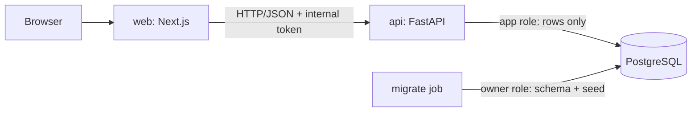

# Technical note: Career Mobility Platform prototype

A user builds a career profile, the system scores 12 fictional opportunities against it and returns a ranked list that explains every score. Any role can be opened for the full breakdown and saved to a shortlist.

## 1. Architecture

- **Frontend:** Next.js 16, React 19, TypeScript, Tailwind. Only its server calls the API, so the profile ID stays in an httpOnly cookie.
- **Backend:** FastAPI, Pydantic 2, SQLAlchemy 2.1, layered as routers → services → repositories. The **matching engine** is a pure Python package with no framework or database imports.
- **Storage:** PostgreSQL 18 with Alembic migrations. A one-off `migrate` job applies the schema and seeds the data before the API starts.
- **External services:** none. Matching is rule-based and runs offline.

## 2. Data model

- `profiles`: education, experience, skills, languages with levels, preferred countries, interests, work authorisation, student status. No name or email.
- `opportunities`: 12 fictional roles from `backend/data/opportunities.json`, validated and upserted by a unique `slug`.
- `shortlist_entries`: `(profile_id, opportunity_id)` as the primary key, so a role can't be saved twice; deleting a profile deletes its shortlist.

Match results are **computed per request, not stored**, so they always reflect the current profile. **Unknown is a real state:** a country missing from `work_authorisations` is unknown, and a student status of `NULL` means not answered.

## 3. Matching method

Score out of 100. Weights are in one place (`backend/app/matching/criteria.py`).

| Criterion | Weight | Rule |
|---|---|---|
| Skills | 35 | 80% required skills matched + 20% preferred, after normalising ("MS Excel" = "Excel") |
| Experience | 20 | Full at or above the minimum; pro rata below |
| Education | 15 | 9 for the level + 6 for an accepted field of study |
| Language | 15 | Share of required languages met at the required level |
| Location | 10 | 10 for a preferred country; 5 for a remote role elsewhere |
| Interests | 5 | Overlap between the user's interests and the role's tags |

Bands: **strong** 75+, **partial** 50–74, **poor** below 50.

- **Missing data scores zero** when the role asks for it. It is never treated as satisfied, and the interface names the empty fields.
- **Eligibility is kept apart from the score.** Language, right-to-work and enrolment checks give **blocked**, **requires verification** or **no known blockers**. Work authorisation is never shown as confirmed, only "verify with the employer", so the app makes no legal determination.
- **Ranking:** open roles first by score; blocked roles keep their real score in a separate group, with the reason.
- **Explanations** are generated only from the per-criterion results, so they cannot claim more than the score shows.

## 4. Validation, errors, security and privacy

- **Validation:** Zod in the browser, Pydantic in the API (length and count limits, unknown fields rejected), and database check constraints.
- **Errors:** one JSON error shape with field-level messages: 422, 404 (names the missing resource), 413, 429, 503 when the database is down, and 500 with no stack trace. The web app shows a plain message instead of crashing.
- **Security:** parameterised SQL, single-origin CORS, Content Security Policy, the database not exposed, a limited database role for the API, non-root containers, a rate limiter, a 64 KB body limit, no profile data in logs.
- **Privacy:** fictional data only, no contact details; "Delete my profile" removes everything. A real deployment would add accounts, HTTPS, encryption at rest, consent and retention rules, and restricted access to work-authorisation data.

## 5. Testing and maintainability

85 backend tests, run with one Docker command (see the test evidence):

- **Engine (41):** the brief's three cases (strong match 91, partial match 73, and a critical gap, the German-language role, blocked at 57), the expected result for all 12 roles, and edge cases.
- **API (40):** profile CRUD, validation and error codes, shortlist, pagination, security headers.
- **Seed and rate limiter (4).**

The frontend passes its type check and lint, and the user journey was tested in a browser, including phone widths. Setup is one command (`sh deployment/start.sh`).

## 6. Key trade-offs

| Decision | Instead of | Why |
|---|---|---|
| Rule-based matching | AI scoring | Transparent, repeatable and offline, with no fallback needed |
| Eligibility separate from score | A score penalty | A penalty hides the reason and could rank a blocked role above an open one |
| Missing data scores zero | Partial credit | Partial credit invents evidence |
| PostgreSQL | SQLite or JSON | Real constraints and cascade deletes; costs a Docker dependency |
| Paging after filtering, in the API | Filtering in the page | Pages are never half empty, and counts cover all roles |

## 7. Known limitations

- No authentication (out of scope): anyone holding a profile's random ID could read it.
- Skill matching is exact after normalisation, and the synonym map is small.
- Every role is scored per request: fine for 12, but it needs database pre-filtering at scale.
- Rate limits are held in memory and reset on restart. Local demo only, over plain HTTP.
- No automated frontend tests, and the Windows start script is untested.
